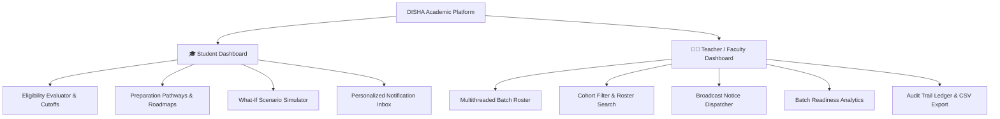

# DISHA: Higher Studies & Competitive Exam Eligibility Engine
## Complete Architecture, OOP Design & Dual-Dashboard Implementation

---

### 1. Executive Summary

**DISHA** is a full-stack, academic eligibility and pathway advising platform designed for universities and higher education institutions. The project combines a modern **React.js** frontend styled strictly according to the **Flat Design System** with a zero-dependency **Core Java** backend demonstrating rigorous Object-Oriented Programming (OOP) paradigms.

The system features **two distinct, purpose-built dashboards**:
1. **Student Dashboard**: Allows students to input their academic profile (CGPA, category, year of study, active backlogs, branch, age, 10th/12th percentages) to generate real-time eligibility across **16 national and international examinations**, explore **curated 4-phase preparation pathways**, simulate academic improvements via a live **"What-If" Simulator**, and receive official announcements in their **Notification Inbox**.
2. **Teacher / Faculty Dashboard**: Equips faculty to evaluate an entire student batch concurrently using a **multithreaded virtual thread engine**, filter students across exam readiness and academic risk criteria, **compose and dispatch targeted broadcast notifications** to eligible student cohorts (persisted to disk), inspect batch analytics, and export CSV audit reports.

---

### 2. Dual-Dashboard Feature Breakdown



#### A. Student Dashboard
- **Profile Configuration & Fast Presets**:
  - Provides quick 1-click loading of benchmark archetypes (e.g. *Aarav Sharma* [High CGPA 2nd Yr IT], *Diya Patel* [OBC candidate with 2 backlogs], *Rohan Verma* [Final year with backlogs], *Ananya Iyer* [Mech topper], *Vikram Singh* [SC candidate with age relaxation]).
  - Custom input controls for CGPA (0.01 precision), Category (General, OBC-NCL, SC, ST, EWS), Current Year (1 to 4), Active Backlogs, Branch, Age, and Senior Secondary marks.
- **Categorized Exam Readiness Results**:
  - Filter results across: *Civil Services (UPSC)*, *Management (CAT/XAT)*, *Defence (CDS/AFCAT)*, *Technical & PSUs (GATE/ISRO/IOCL)*, *Higher Studies Abroad (GRE/GMAT)*, and *Government & Banking (SSC CGL/IBPS PO)*.
  - High-contrast visual cards highlighting cutoffs, candidate margins, and granular shortfall diagnostics.
  - Actionable remediation advice (e.g., specific backlog clearance milestones before semester 7).
- **Suggested Preparation Pathways**:
  - Structured 4-Phase Roadmaps (*Foundation & Basics*, *Standard Books & Optionals*, *Mock Tests & Analysis*, *Interview / SSB Conditioning*).
  - Recommended booklists and weekly study timetables tailored for undergraduate engineering schedules.
- **"What-If" Eligibility Simulator**:
  - Live interactive sliders for Target CGPA (5.0 - 10.0), Backlog Remediation (0 - 5), and Academic Year.
  - Immediate projection recalculation demonstrating which exams unlock as academic parameters improve.
- **Notification Inbox**:
  - Displays official faculty circulars, mentorship invites, and urgent remedial alerts broadcasted by teachers.

#### B. Teacher / Faculty Dashboard
- **Multithreaded Concurrent Batch Roster**:
  - Evaluates batch student profiles concurrently utilizing Core Java virtual threads and concurrent task executors.
  - Displays real-time engine telemetry: **Execution duration in milliseconds**, **Worker threads utilized**, and **Total exams evaluated**.
- **Dynamic Multi-Criteria Filters**:
  - Filter batch roster by specific exam eligibility (*"Eligible for UPSC CSE"*, *"Eligible for CAT"*, *"Eligible for GATE"*, *"Eligible for GRE"*, etc.).
  - Filter by Engineering Branch (CSE, IT, ECE, EE, ME, CE) and Academic Year.
  - Filter by Academic Risk (*Students with active backlogs* or *CGPA < 6.5*).
- **Informing & Notifying Eligible Students**:
  - Integrated notification composer with pre-built faculty announcement templates.
  - Automatically identifies and previews recipient manifest based on active roster filters.
  - Dispatches announcements directly to student inboxes and persists them to `data/notifications.json`.
- **Batch Readiness Analytics**:
  - Percentage distribution of batch eligibility across major competitive examinations.
  - Distinction cohort tracking (CGPA ≥ 8.5) and an **Arrears Remedial Watchlist** flagging students at risk.
- **Data Export & Batch Enrollment**:
  - 1-click CSV export of batch eligibility metrics.
  - Direct student enrollment modal to append candidate records to `data/students_sample.csv`.

---

### 3. Flat Design System Implementation

The UI adheres strictly to the provided **Flat Design Philosophy**:
- **Zero Artificial Depth**: No drop shadows (`shadow-none`), no bevels, no blurry backdrops (`backdrop-filter: none`), and no 3D illusions.
- **Color as Structure**:
  - Canvas: Pure White (`#FFFFFF`) on Light Neutral (`#F3F4F6`).
  - High-Contrast Text: Sharp Gray 900 (`#111827`).
  - Primary Action: Pure Digital Blue (`#3B82F6`).
  - Positive / Eligible: Emerald Green (`#10B981`).
  - Shortfall / Caution: Amber (`#F59E0B`).
  - Urgent / Danger: Crimson Red (`#EF4444`).
  - Dark Accent Sections: Dark Slate (`#1F2937`).
- **Typography**: Geometric **'Outfit', sans-serif** from Google Fonts with bold headings (-0.02em tracking) and strong weight contrast.
- **Snappy Motion Feedback**: Instant color shifts, button scaling (`hover:scale-105`), card scaling (`hover:scale-[1.02]`), and bold borders (`border-2` and `border-4`).
- **Iconography**: `lucide-react` icons housed within solid colored geometric badge containers.

---

### 4. Core Java Backend & OOP Architecture

```
backend/src/com/disha/
├── DishaApplication.java            # Main runner, CLI menu, background daemon
├── engine/
│   ├── EligibilityEngine.java       # Polymorphic dispatch engine & catalog
│   ├── ConcurrentEvaluationEngine.java # Multithreaded ExecutorService batch runner
│   └── ShortfallReporter.java       # Remediation synthesis reporter
├── exams/
│   ├── Exam.java                    # Abstract Base Class (Template Method Pattern)
│   ├── ExamType.java                # Enum for exam domains
│   ├── CivilServicesExam.java       # UPSC CSE domain model with category attempts
│   ├── ManagementExam.java          # CAT/XAT domain model with graduation % logic
│   ├── DefenceExam.java             # CDS/AFCAT domain model with gender/branch logic
│   ├── TechnicalExam.java           # GATE/ISRO/PSU domain model with branch sets
│   ├── AbroadHigherStudiesExam.java # GRE/GMAT global admissions domain model
│   ├── GovernmentBankingExam.java   # SSC CGL/IBPS PO administrative domain model
│   └── CorporateDriveExam.java      # Product & National Qualifier hiring model
├── models/
│   ├── Student.java                 # Encapsulated student profile
│   ├── Notification.java            # Encapsulated faculty broadcast record
│   ├── EvaluationResult.java        # Immutable evaluation status record
│   ├── ShortfallDetail.java         # Diagnostic criteria shortfall model
│   ├── Branch.java                  # Engineering discipline enum
│   ├── Category.java                # Social category enum with age/cutoff relaxations
│   └── Gender.java                  # Gender enum
├── io/
│   ├── NotificationStore.java       # Thread-safe File Handling for notifications
│   ├── StudentFileReader.java       # CSV file parser with validation
│   ├── AuditLogWriter.java          # File writer appending execution audit logs
│   └── ReportExporter.java          # Batch report generator
├── exceptions/
│   ├── InvalidStudentDataException.java
│   ├── NotificationValidationException.java
│   └── ExamNotFoundException.java
└── server/
    └── DishaHttpServer.java         # Lightweight Java HttpServer REST API provider
```

#### Core OOP Concepts Demonstrated:

| OOP Concept | Implementation Details |
| :--- | :--- |
| **Encapsulation** | Strict private fields with defensive copies and validation in [Student.java](file:///C:/Users/samru/.gemini/antigravity-ide/scratch/disha-eligibility-engine/backend/src/com/disha/models/Student.java), [Notification.java](file:///C:/Users/samru/.gemini/antigravity-ide/scratch/disha-eligibility-engine/backend/src/com/disha/models/Notification.java), and [Exam.java](file:///C:/Users/samru/.gemini/antigravity-ide/scratch/disha-eligibility-engine/backend/src/com/disha/exams/Exam.java). Immutable collections (`Collections.unmodifiableList`, `EnumSet.copyOf`). |
| **Inheritance** | Base abstract class [Exam.java](file:///C:/Users/samru/.gemini/antigravity-ide/scratch/disha-eligibility-engine/backend/src/com/disha/exams/Exam.java) extended by specialized subclasses: `CivilServicesExam`, `ManagementExam`, `DefenceExam`, `TechnicalExam`, `AbroadHigherStudiesExam`, `GovernmentBankingExam`, and `CorporateDriveExam`. |
| **Polymorphism** | Dynamic Method Dispatch in [EligibilityEngine.java](file:///C:/Users/samru/.gemini/antigravity-ide/scratch/disha-eligibility-engine/backend/src/com/disha/engine/EligibilityEngine.java#L52-L64) calling `exam.checkEligibility(student)`. Subclasses override `evaluateDomainSpecificRules()` and `generateEligibleAdvice()` to inject specialized logic. |
| **File Handling** | [NotificationStore.java](file:///C:/Users/samru/.gemini/antigravity-ide/scratch/disha-eligibility-engine/backend/src/com/disha/io/NotificationStore.java) and [AuditLogWriter.java](file:///C:/Users/samru/.gemini/antigravity-ide/scratch/disha-eligibility-engine/backend/src/com/disha/io/AuditLogWriter.java) utilize `java.nio.file.Files`, `BufferedReader`, `BufferedWriter`, and `StandardOpenOption` to persist notifications and audit trails to disk. |
| **Multithreading** | [ConcurrentEvaluationEngine.java](file:///C:/Users/samru/.gemini/antigravity-ide/scratch/disha-eligibility-engine/backend/src/com/disha/engine/ConcurrentEvaluationEngine.java) executes batch evaluations across thread pools using `Callable<BatchStudentTask>` and `Future`. `ReentrantReadWriteLock` ensures thread-safe file operations in `NotificationStore`. |
| **Exception Handling** | Custom checked and unchecked exceptions (`InvalidStudentDataException`, `NotificationValidationException`, `ExamNotFoundException`) with structured error mapping in [DishaHttpServer.java](file:///C:/Users/samru/.gemini/antigravity-ide/scratch/disha-eligibility-engine/backend/src/com/disha/server/DishaHttpServer.java). |

---

### 5. Verified REST API Endpoints

The embedded Java HTTP Server runs on `http://localhost:8080` and exposes the following endpoints:

| Method | Endpoint | Description |
| :--- | :--- | :--- |
| `GET` | `/api/health` | Health check returning service status |
| `GET` | `/api/exams` | Catalog of all 16 registered national examinations |
| `POST` | `/api/evaluate` | Evaluates a single student profile and returns status + shortfalls |
| `GET` | `/api/batch-sample` | Triggers multithreaded evaluation of batch CSV with concurrency telemetry |
| `POST` | `/api/batch-add-student` | Appends a candidate record to the CSV roster on disk |
| `GET` | `/api/notifications` | Returns notifications (filterable by `?studentId=...`) |
| `POST` | `/api/notifications` | Faculty endpoint to broadcast announcements to eligible student cohorts |
| `GET` | `/api/pathways` | Returns 4-phase preparation roadmaps, booklists, and timetables |
| `GET` | `/api/logs` | Real-time stream of audit logs from `data/audit_logs.txt` |
| `GET` | `/` | Serves the production React Single Page Application (SPA) |
